<div align="center">

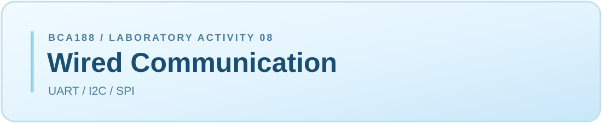

**ESP32-DevKitC (ESP-WROOM-32)** · **Arduino IDE** · **Laboratory Documentation**

</div>

---

## Navigation

<div align="center">

<a href="#project-overview"></a><a href="#materials-and-equipment"></a><a href="#gpio-pin-assignments"></a>

<a href="#wiring-diagrams"></a><a href="#uart-loopback-testing"></a><a href="#i2c-scanner-testing"></a>

<a href="#spi-loopback-testing"></a><a href="#baud-rate-experiment"></a><a href="#expected-vs-observed-results"></a>

<a href="#guide-questions"></a>
</div>

---

## Project Overview


This laboratory verifies three ESP32 wired communication interfaces: **UART**, **I2C**, and **SPI**. Each interface is tested using an Arduino sketch to compare expected and observed behavior with and without the required hardware connection.

### Objectives

- Verify UART communication using a TX-to-RX loopback connection.
- Detect an I2C OLED display using address scanning.
- Verify SPI data transfer using a MOSI-to-MISO loopback connection.
- Compare communication behavior with and without physical connections.
- Examine the effects of mismatched USB serial baud rates.

---

## Materials and Equipment


| Material | Purpose |
|:---|:---|
| ESP32-DevKitC (ESP-WROOM-32) | Main microcontroller |
| USB Type-C Cable | Power, programming, and Serial Monitor connection |
| Breadboard | Circuit prototyping |
| Jumper Wires | Loopback and peripheral wiring |
| I2C OLED Display | I2C address-scanning test |
| Computer with Arduino IDE | Sketch uploading and observation |

---

## GPIO Pin Assignments


The following GPIO pins were used during the laboratory activity.

| Interface | Signal | GPIO Used |
|:---|:---|:---:|
| UART | TX | **17** |
| UART | RX | **16** |
| I2C | SDA | **32** |
| I2C | SCL | **33** |
| SPI | SCK | **14** |
| SPI | MOSI | **13** |
| SPI | MISO | **26** |
| SPI | CS | **27** |

> **Pin Selection:** The lecture uses GPIO4 for SPI CS, but GPIO27 was selected to avoid using a strapping pin, following the MOLE laboratory instructions. The remaining GPIO assignments follow the course reference.

---

## Wiring Diagrams


The following diagrams illustrate the connections used to verify each communication interface.

**Safety Reminder:** Disconnect the USB cable before adding or removing jumper wires. Power the OLED module using the ESP32's 3.3V supply.

### UART — TX/RX Loopback


**Physical Connection:** GPIO17 (TX) to GPIO16 (RX).

The transmitted UART data is returned directly to the receiving pin using a jumper wire.

### I2C — OLED Module

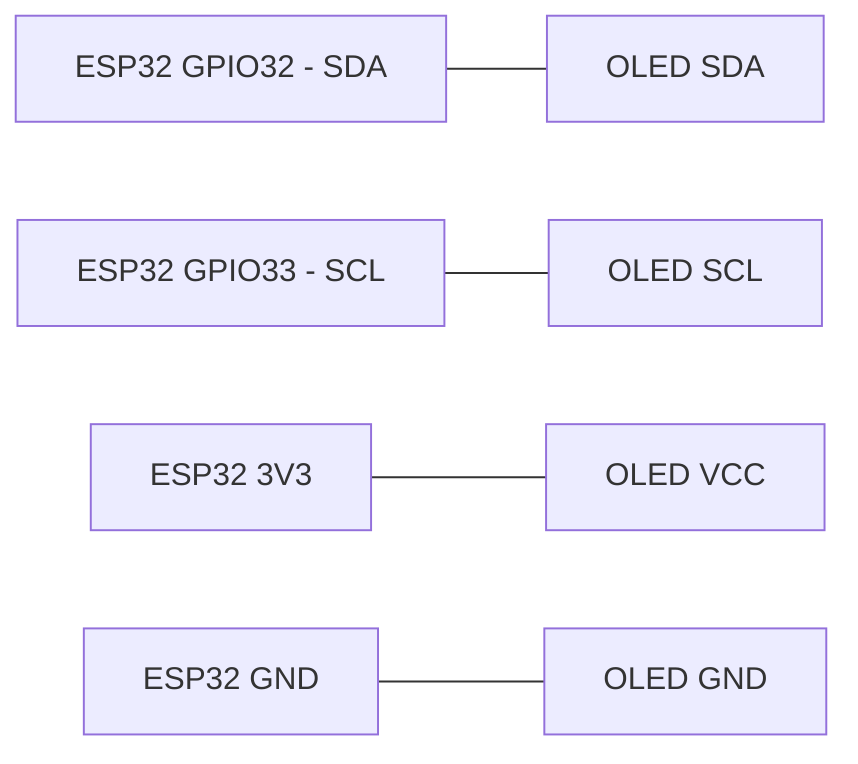

| OLED Pin | ESP32 Pin |
|:---|:---|
| SDA | GPIO32 |
| SCL | GPIO33 |
| VCC | 3V3 |
| GND | GND |

The OLED uses SDA and SCL for I2C communication and receives power from the ESP32's 3.3V supply.

### SPI — MOSI/MISO Loopback

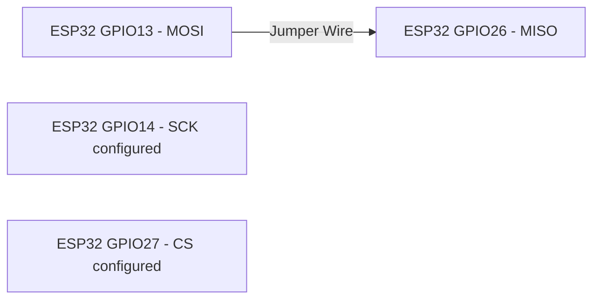

**Physical Connection:** GPIO13 (MOSI) to GPIO26 (MISO).

GPIO14 (SCK) and GPIO27 (CS) are configured in the sketch but do not require additional jumper connections for this loopback test.

---

## UART Loopback Testing


**Source Code:** [`uart_loopback.ino`](uart_loopback/uart_loopback.ino)

### Configuration

| Parameter | Setting |
|:---|:---|
| Interface | Serial2 |
| UART TX | GPIO17 |
| UART RX | GPIO16 |
| UART Baud Rate | 9600 |
| USB Serial Baud Rate | 115200 |
| Data Format | 8N1 |
| Transmission Interval | 1 second |

### Test 1 — UART With Jumper

**Expected:** The Serial Monitor should display `PING` every second when UART TX and RX are connected.

**Observed:** The ESP32 successfully received the transmitted messages, displaying repeated `PING` outputs.

```text
PING
PING
PING
PING
```

<details>
<summary><b>View UART With Jumper — Serial Monitor Screenshot</b></summary>

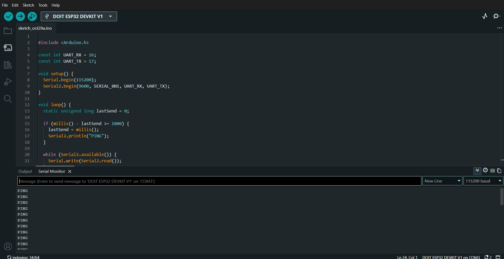

</details>

### Test 2 — UART Without Jumper

**Expected:** No new `PING` messages should be received after disconnecting the TX-to-RX jumper.

**Observed:** The repeated incoming `PING` messages stopped after removing the jumper connection. Previously displayed messages remained visible in the Serial Monitor.

<details>
<summary><b>View UART Without Jumper — Serial Monitor Screenshot</b></summary>

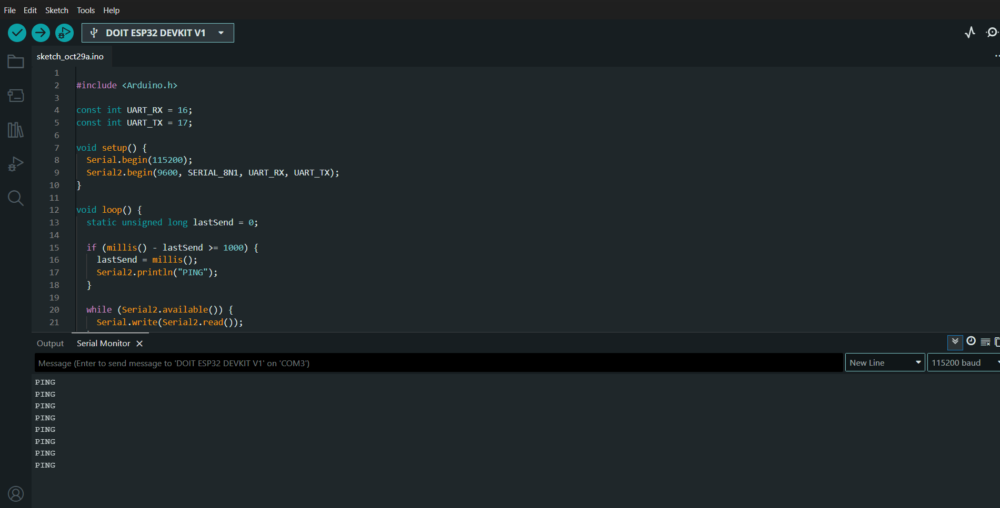

</details>

### UART Analysis

UART transmits and receives data through separate TX and RX pins. Connecting these pins creates a loopback path that allows transmitted data to return to the same ESP32.

Removing the jumper disconnects the return path, preventing the transmitted messages from being received through UART2.

[](#navigation)

---

## I2C Scanner Testing


**Source Code:** [`i2c_scanner.ino`](i2c_scanner/i2c_scanner.ino)

### Configuration

| Parameter | Setting |
|:---|:---|
| Interface | I2C (Wire) |
| SDA | GPIO32 |
| SCL | GPIO33 |
| Peripheral | OLED Display |
| Detected Address | 0x3C |
| Serial Monitor | 115200 baud |

### Test 3 — I2C With OLED

**Expected:** The I2C scanner should detect the connected OLED display and report its address.

**Observed:** The ESP32 successfully detected the OLED module at I2C address `0x3C`.

```text
Found device at 0x3C
```

<details>
<summary><b>View I2C With OLED — Serial Monitor Screenshot</b></summary>

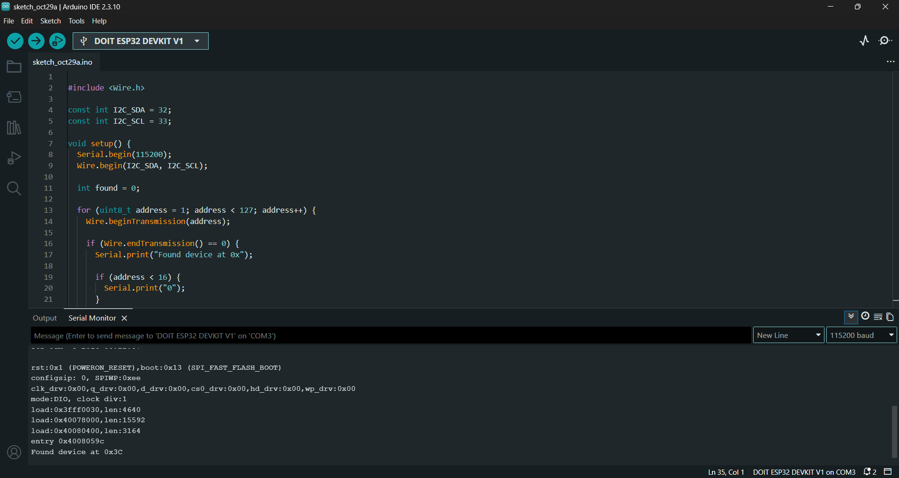

</details>

### Test 4 — I2C Without OLED

**Expected:** The I2C scanner should report `No I2C devices found` after disconnecting the OLED module.

**Observed:** After removing the OLED connections, the Serial Monitor displayed `No I2C devices found`, confirming that no I2C devices were detected on the bus.

```text
No I2C devices found
```

<details>
<summary><b>View I2C Without OLED — Serial Monitor Screenshot</b></summary>

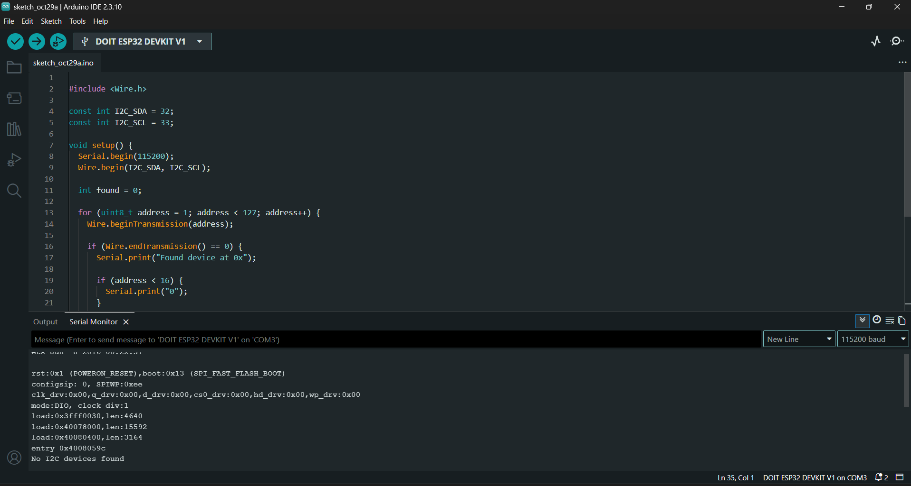

</details>

### I2C Analysis

I2C communication uses two shared signal lines, SDA and SCL, to communicate with peripheral devices through unique addresses.

The scanner successfully identified the connected OLED at address `0x3C`. When the OLED was disconnected, the scanner reported that no devices were found.

The OLED did not need to display graphics or text because the scanner only checked for device acknowledgment.

[](#navigation)

---

## SPI Loopback Testing


**Source Code:** [`spi_loopback.ino`](spi_loopback/spi_loopback.ino)

### Configuration

| Parameter | Setting |
|:---|:---|
| Interface | SPI |
| SCK | GPIO14 |
| MOSI | GPIO13 |
| MISO | GPIO26 |
| CS | GPIO27 |
| Clock Frequency | 1 MHz |
| Bit Order | MSB First |
| SPI Mode | Mode 0 |
| Transmitted Byte | 0xA5 |
| Transfer Interval | 1 second |

### Test 5 — SPI With Jumper

**Expected:** The received byte should match the transmitted byte `0xA5` when MOSI and MISO are connected.

**Observed:** The ESP32 consistently received `0xA5`, matching the transmitted byte and confirming successful SPI loopback communication.

```text
Sent 0xA5, received 0xA5
Sent 0xA5, received 0xA5
Sent 0xA5, received 0xA5
```

<details>
<summary><b>View SPI With Jumper — Serial Monitor Screenshot</b></summary>

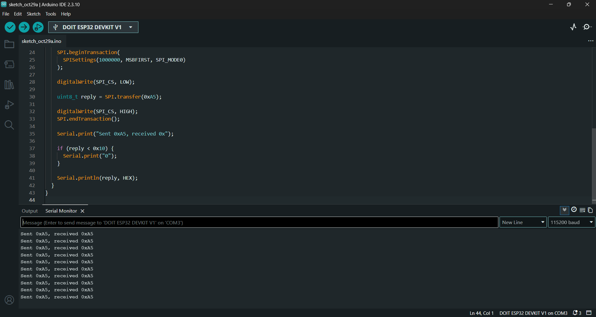

</details>

### Test 6 — SPI Without Jumper

**Expected:** The received byte should differ from the transmitted byte because MOSI and MISO are no longer connected.

**Observed:** The ESP32 consistently received `0x00` instead of `0xA5`.

```text
Sent 0xA5, received 0x00
Sent 0xA5, received 0x00
Sent 0xA5, received 0x00
```

<details>
<summary><b>View SPI Without Jumper — Serial Monitor Screenshot</b></summary>

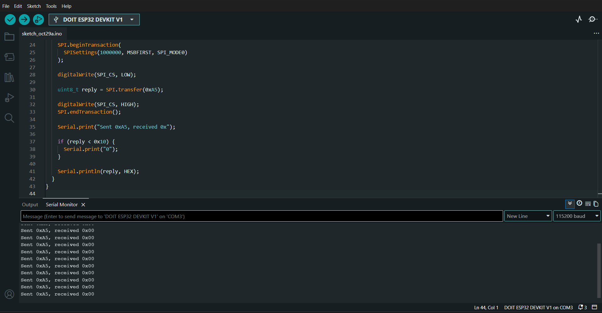

</details>

### SPI Analysis

SPI uses separate MOSI and MISO data lines and a dedicated clock signal to synchronize transfers.

When MOSI and MISO were connected, the transmitted byte `0xA5` was successfully received. After removing the jumper, the MISO input was left unconnected, producing a received value of `0x00` during the experiment.

Since an unconnected input can produce unpredictable values, `0x00` represents the actual observed result rather than a guaranteed output.

[](#navigation)

---

## Baud Rate Experiment


This experiment demonstrates the importance of matching baud rates between the ESP32 USB serial connection and the Arduino Serial Monitor.

The UART loopback jumper remained connected between GPIO17 and GPIO16.

### Test 7 — Mismatched Baud Rates

| Parameter | Setting |
|:---|:---|
| Serial.begin() | 9600 |
| Serial2.begin() | 9600 |
| Serial Monitor | 115200 baud |

**Expected:** The Serial Monitor should display unreadable or corrupted characters because the baud rates do not match.

**Observed:** The Serial Monitor displayed garbled output represented by square symbols instead of readable `PING` messages.

<details>
<summary><b>View Baud Rate Mismatch — Serial Monitor Screenshot</b></summary>

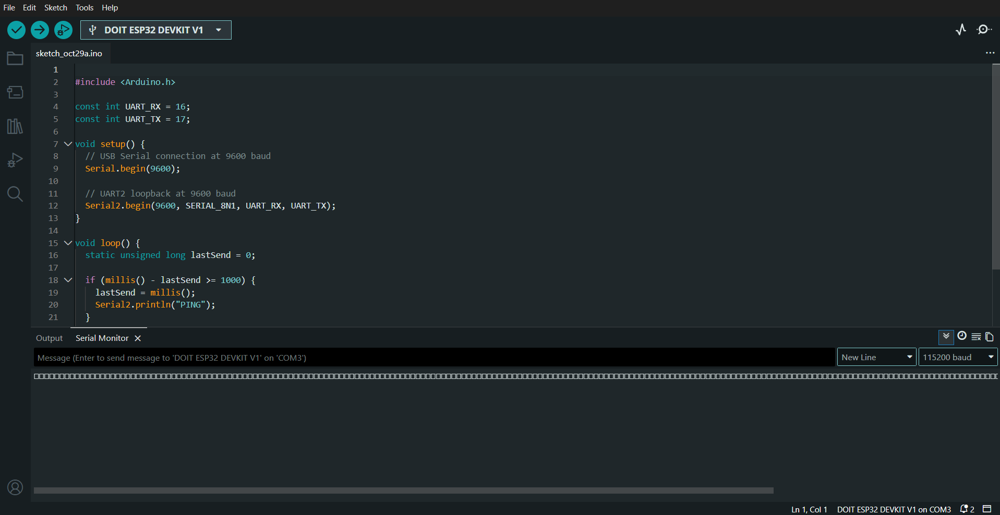

</details>

### Test 8 — Matched Baud Rates

| Parameter | Setting |
|:---|:---|
| Serial.begin() | 9600 |
| Serial2.begin() | 9600 |
| Serial Monitor | 9600 baud |

**Expected:** The Serial Monitor should display readable `PING` messages every second.

**Observed:** Readable `PING` messages appeared repeatedly after changing the Serial Monitor baud rate to 9600.

```text
PING
PING
PING
PING
```

<details>
<summary><b>View Matched Baud Rate — Serial Monitor Screenshot</b></summary>

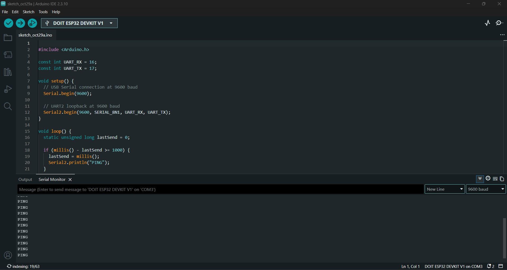

</details>

### Baud Rate Analysis

UART communication depends on timing agreement between the transmitter and receiver.

When the ESP32 USB serial baud rate and the Serial Monitor baud rate were different, the output became unreadable. Matching both baud rates restored readable communication.

After the experiment, the USB serial connection was restored to `115200` baud, while `Serial2` remained at `9600` baud.

[](#navigation)

---

## Expected vs Observed Results


The following table summarizes the expected and observed results of all eight laboratory tests.

| Test | Expected | Observed |
|:---|:---|:---|
| UART with jumper | `PING` every second | Repeated `PING` messages |
| UART without jumper | No new `PING` | Incoming `PING` messages stopped |
| I2C with OLED | OLED address detected | `Found device at 0x3C` |
| I2C without OLED | `No I2C devices found` | `No I2C devices found` |
| SPI with jumper | Receives `0xA5` | Received `0xA5` |
| SPI without jumper | Different or undefined received value | Received `0x00` |
| Sketch 9600, Monitor 115200 | Unreadable characters | Garbled square symbols |
| Sketch 9600, Monitor 9600 | Readable `PING` | Repeated `PING` messages |

---

## Guide Questions


### 1. Why does UART need both sides to use the same baud rate, while SPI uses a clock line?

UART is asynchronous and does not use a separate clock signal, so both devices must use matching baud rates to interpret transmitted bits correctly. SPI uses a dedicated clock line to synchronize data transmission and reception.

### 2. Why can two devices with the same address not share one I2C bus?

Two I2C devices with the same address would respond to the same communication request, potentially causing bus conflicts and incorrect data transmission.

### 3. Why is CS set HIGH between SPI transfers?

CS is set HIGH to deselect the SPI device when no communication is taking place. This prevents unintended communication and allows other SPI devices to use the bus.

[](#navigation)

<div align="center">

**BCA188 — Laboratory Activity 8**

*Wired Communication · UART / I2C / SPI*

<a href="#navigation"></a>

</div>
