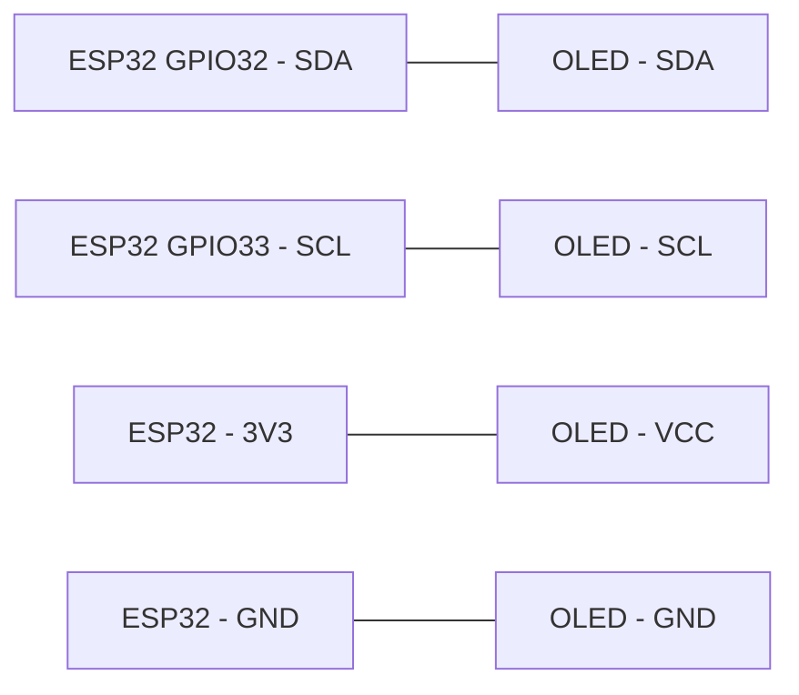
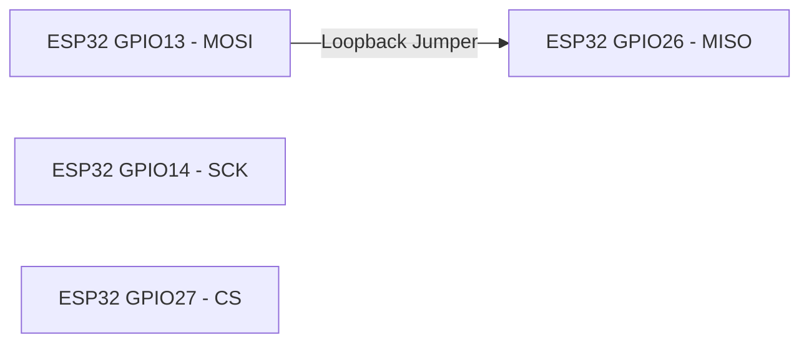

<div align="center">

# BCA188 — Laboratory Activity 8

### Wired Communication: UART, I2C, and SPI

**ESP32-DevKitC | ESP-WROOM-32 | Arduino IDE**

**Laboratory Documentation and Testing Results**

---

</div>

## Navigation

Click any section to jump directly to its contents.

- [01 — Project Overview](#01--project-overview)
- [02 — Materials and Equipment](#02--materials-and-equipment)
- [03 — GPIO Pin Assignments](#03--gpio-pin-assignments)
- [04 — Wiring Diagrams](#04--wiring-diagrams)
- [05 — UART Loopback Testing](#05--uart-loopback-testing)
- [06 — I2C Scanner Testing](#06--i2c-scanner-testing)
- [07 — SPI Loopback Testing](#07--spi-loopback-testing)
- [08 — UART Baud Rate Experiment](#08--uart-baud-rate-experiment)
- [09 — Expected vs Observed Results](#09--expected-vs-observed-results)
- [10 — Guide Questions](#10--guide-questions)
- [11 — Conclusion](#11--conclusion)

---

## 01 — Project Overview

This laboratory activity verifies three wired communication interfaces on the ESP32 microcontroller: Universal Asynchronous Receiver/Transmitter (UART), Inter-Integrated Circuit (I2C), and Serial Peripheral Interface (SPI).

Each interface is tested using an Arduino sketch to examine its communication behavior under different connection conditions.

### Objectives

- Verify UART communication using a TX-to-RX loopback connection.
- Detect an I2C OLED module using an address scanner.
- Verify SPI data transfer using a MOSI-to-MISO loopback connection.
- Observe communication differences with and without physical connections.
- Examine the effect of mismatched serial baud rates.

## 02 — Materials and Equipment

| Component | Purpose |
|---|---|
| ESP32-DevKitC (ESP-WROOM-32) | Main microcontroller |
| USB Type-C Cable | Power, programming, and serial communication |
| Breadboard | Circuit prototyping |
| Jumper Wires | Communication connections |
| I2C OLED Display | I2C peripheral for address detection |
| Computer with Arduino IDE | Programming, uploading, and monitoring |

## 03 — GPIO Pin Assignments

The following GPIO assignments were used during the laboratory tests.

| Interface | Signal | ESP32 GPIO |
|---|---|---|
| UART | TX | GPIO17 |
| UART | RX | GPIO16 |
| I2C | SDA | GPIO32 |
| I2C | SCL | GPIO33 |
| SPI | SCK | GPIO14 |
| SPI | MOSI | GPIO13 |
| SPI | MISO | GPIO26 |
| SPI | CS | GPIO27 |

**Note:** GPIO27 was selected for SPI Chip Select instead of GPIO4 to avoid using a strapping pin.

## 04 — Wiring Diagrams

The following diagrams illustrate the connections used for each wired communication test.

### 4.1 UART Loopback Wiring


**Connection:** GPIO17 (TX) to GPIO16 (RX).

The transmitted UART data is returned directly to the receiving pin through a jumper wire.

### 4.2 I2C OLED Wiring



| OLED Pin | ESP32 Connection |
|---|---|
| SDA | GPIO32 |
| SCL | GPIO33 |
| VCC | 3V3 |
| GND | GND |

The OLED module communicates through the SDA and SCL lines and is powered using the ESP32's 3.3V supply.

### 4.3 SPI Loopback Wiring



**Connection:** GPIO13 (MOSI) to GPIO26 (MISO).

GPIO14 (SCK) and GPIO27 (CS) are configured by the SPI sketch but do not require additional external jumper connections for this loopback test.

---

## 05 — UART Loopback Testing

**Source Code:** [uart_loopback.ino](uart_loopback/uart_loopback.ino)

### Configuration

| Parameter | Value |
|---|---|
| Interface | Serial2 |
| TX | GPIO17 |
| RX | GPIO16 |
| UART Baud Rate | 9600 |
| USB Serial Baud Rate | 115200 |
| Data Format | 8N1 |
| Transmission Interval | 1 second |

### Test 1 — UART With Jumper

**Expected:** The ESP32 transmits `PING` every second, which is received through the loopback connection.

**Observed:** The Serial Monitor displayed repeated `PING` messages, confirming successful UART loopback communication.

```text
PING
PING
PING
PING
```

<details>
<summary>📷 Click to view UART With Jumper Screenshot</summary>


</details>

### Test 2 — UART Without Jumper

**Expected:** No new `PING` messages should be received after removing the TX-to-RX jumper connection.

**Observed:** The previously displayed messages remained in the Serial Monitor, but the repeated incoming `PING` messages stopped after disconnecting the jumper.

<details>
<summary>📷 Click to view UART Without Jumper Screenshot</summary>


</details>

### UART Analysis

The loopback connection allows transmitted UART data to return to the receiving pin. Without the physical connection, the transmitted data is no longer reliably received.

[Back to Navigation](#navigation)

---

## 06 — I2C Scanner Testing

**Source Code:** [i2c_scanner.ino](i2c_scanner/i2c_scanner.ino)

### Configuration

| Parameter | Value |
|---|---|
| Interface | I2C (Wire) |
| SDA | GPIO32 |
| SCL | GPIO33 |
| Device | I2C OLED Display |
| Detected Address | 0x3C |
| Serial Monitor | 115200 baud |

### Test 3 — I2C With OLED

**Expected:** The I2C scanner detects the connected OLED module and reports its address.

**Observed:** The ESP32 successfully detected the OLED at address `0x3C`.

```text
Found device at 0x3C
```

<details>
<summary>📷 Click to view I2C With OLED Screenshot</summary>


</details>

### Test 4 — I2C Without OLED

**Expected:** The scanner reports that no I2C devices were detected after disconnecting the OLED.

**Recorded output:**

```text
No I2C devices found
```

<details>
<summary>📷 Click to view I2C Without OLED Screenshot</summary>


</details>

### I2C Analysis

The I2C scanner identifies connected peripherals using their addresses. The OLED responded at `0x3C`, demonstrating successful address-based device detection.

The OLED does not need to display text or graphics during this test because the scanner only checks for device acknowledgment.

[Back to Navigation](#navigation)

---

## 07 — SPI Loopback Testing

**Source Code:** [spi_loopback.ino](spi_loopback/spi_loopback.ino)

### Configuration

| Parameter | Value |
|---|---|
| Interface | SPI |
| SCK | GPIO14 |
| MOSI | GPIO13 |
| MISO | GPIO26 |
| CS | GPIO27 |
| Clock Frequency | 1 MHz |
| Bit Order | MSB First |
| SPI Mode | Mode 0 |
| Transmitted Data | 0xA5 |

### Test 5 — SPI With Jumper

**Expected:** The transmitted byte `0xA5` should be received through the MOSI-to-MISO loopback connection.

**Observed:** The received byte consistently matched the transmitted byte.

```text
Sent 0xA5, received 0xA5
Sent 0xA5, received 0xA5
Sent 0xA5, received 0xA5
```

<details>
<summary>📷 Click to view SPI With Jumper Screenshot</summary>


</details>

### Test 6 — SPI Without Jumper

**Expected:** The received byte may differ from `0xA5` because MISO is no longer connected to MOSI.

**Observed:** The ESP32 consistently received `0x00` instead of the transmitted `0xA5`.

```text
Sent 0xA5, received 0x00
Sent 0xA5, received 0x00
Sent 0xA5, received 0x00
```

<details>
<summary>📷 Click to view SPI Without Jumper Screenshot</summary>


</details>

### SPI Analysis

SPI transfers data through separate MOSI and MISO lines. Connecting the two pins allows the transmitted byte to be read back.

When the jumper is removed, MISO becomes unconnected and its value is not guaranteed. In this experiment, the ESP32 read `0x00`.

[Back to Navigation](#navigation)

---

## 08 — UART Baud Rate Experiment

This experiment examines the effect of using different baud rates between the ESP32 USB serial connection and the Arduino Serial Monitor.

The UART loopback jumper remained connected between GPIO17 and GPIO16.

### Test 7 — Mismatched Baud Rates

| Setting | Baud Rate |
|---|---|
| Serial.begin() | 9600 |
| Serial Monitor | 115200 |
| Serial2 | 9600 |

**Expected:** The Serial Monitor displays unreadable or corrupted characters because the baud rates do not match.

**Observed:** The Serial Monitor displayed garbled output represented by square symbols instead of readable `PING` messages.

<details>
<summary>📷 Click to view Baud Rate Mismatch Screenshot</summary>


</details>

### Test 8 — Matched Baud Rates

| Setting | Baud Rate |
|---|---|
| Serial.begin() | 9600 |
| Serial Monitor | 9600 |
| Serial2 | 9600 |

**Expected:** The Serial Monitor correctly displays `PING` every second.

**Observed:** Readable `PING` messages appeared repeatedly after changing the Serial Monitor to 9600 baud.

```text
PING
PING
PING
PING
```

<details>
<summary>📷 Click to view Matched Baud Rate Screenshot</summary>


</details>

### Baud Rate Analysis

UART communication depends on timing agreement between the transmitter and receiver. When the USB serial baud rate did not match the Serial Monitor, the received characters became unreadable.

Restoring matching baud rates allowed the transmitted messages to appear correctly.

After the experiment, the USB serial baud rate was restored to 115200.

[Back to Navigation](#navigation)

---

## 09 — Expected vs Observed Results

| Test | Expected | Observed |
|---|---|---|
| UART with jumper | `PING` every second | Repeated `PING` messages |
| UART without jumper | No new `PING` | Incoming `PING` messages stopped |
| I2C with module | OLED address detected | `Found device at 0x3C` |
| I2C without module | No devices detected | `No I2C devices found` |
| SPI with jumper | Receives `0xA5` | Received `0xA5` |
| SPI without jumper | Different or undefined received value | Received `0x00` |
| Sketch 9600, Monitor 115200 | Unreadable characters | Garbled square symbols |
| Sketch 9600, Monitor 9600 | Readable `PING` | Repeated `PING` messages |

---

## 10 — Guide Questions

### 1. Why does UART need both sides to use the same baud rate, while SPI uses a clock line?

UART is asynchronous and does not use a separate clock signal, so both devices must use matching baud rates to interpret the transmitted bits correctly. SPI uses a dedicated clock line to synchronize data transmission and reception.

### 2. Why can two devices with the same address not share one I2C bus?

Two I2C devices with the same address would respond to the same communication request, potentially causing bus conflicts and incorrect data transmission.

### 3. Why is CS set HIGH between SPI transfers?

CS is set HIGH to deselect the SPI device when no communication is occurring. This prevents the device from responding to unintended transfers and allows other SPI devices to use the bus.

---

## 11 — Conclusion

Laboratory Activity 8 demonstrated the operation of UART, I2C, and SPI communication interfaces using the ESP32-DevKitC.

UART loopback successfully returned the transmitted `PING` messages when TX and RX were connected. The I2C scanner detected the OLED module at address `0x3C`, while SPI loopback successfully returned the transmitted byte `0xA5`.

The tests also demonstrated how removing physical connections affects communication and how mismatched baud rates can cause unreadable serial output.

Overall, the activity provided practical experience in configuring, testing, and troubleshooting wired communication interfaces on the ESP32.

---

<div align="center">

**BCA188 — Laboratory Activity 8**

*Wired Communication | UART • I2C • SPI*

**[Back to Navigation](#navigation)**

</div>
