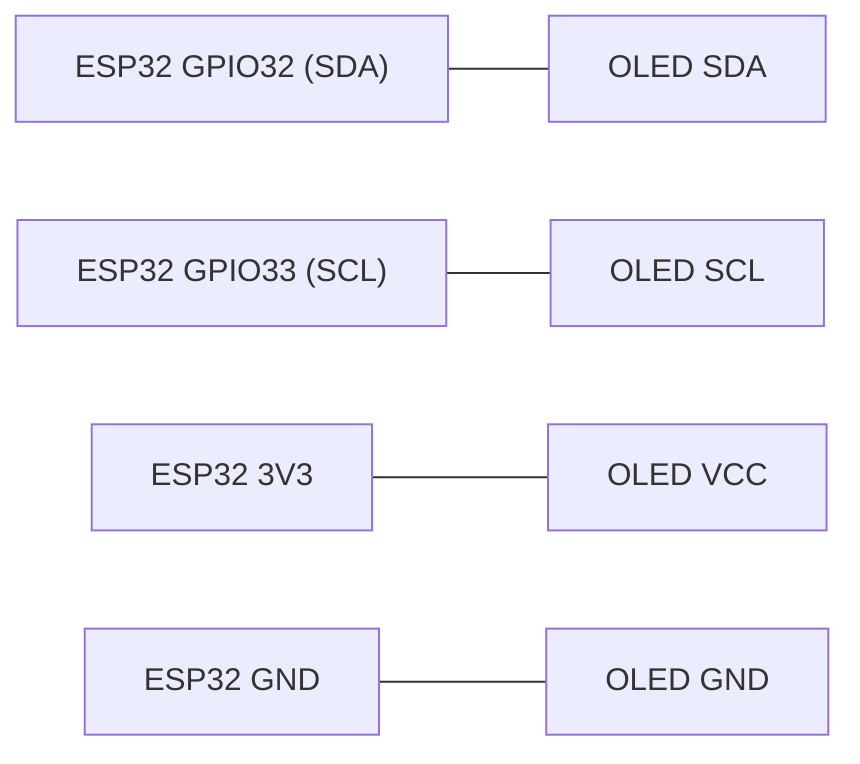
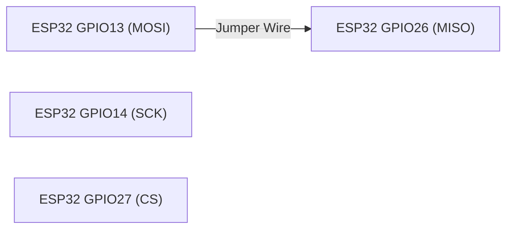

<div align="center">

# BCA188 — Laboratory Activity 8

### Wired Communication: UART, I2C, and SPI

**ESP32-DevKitC | ESP-WROOM-32 | Arduino IDE**

*Laboratory Documentation and Testing Results*

---

</div>

## Navigation

<div align="center">

[](#project-overview)
[](#materials-and-equipment)
[](#gpio-pin-assignments)

[](#wiring-diagrams)
[](#uart-loopback-testing)
[](#i2c-scanner-testing)

[](#spi-loopback-testing)
[](#baud-rate-experiment)
[](#expected-vs-observed-results)

[](#guide-questions)
[](#conclusion)

</div>

---

## Project Overview

This laboratory activity focuses on verifying three wired communication interfaces on the ESP32 microcontroller: Universal Asynchronous Receiver/Transmitter (UART), Inter-Integrated Circuit (I2C), and Serial Peripheral Interface (SPI).

Each interface is tested using an Arduino sketch to observe its communication behavior under different connection conditions.

### Objectives

- Verify UART communication using a TX-to-RX loopback connection.
- Detect an I2C OLED module through address scanning.
- Verify SPI data transfer using a MOSI-to-MISO loopback connection.
- Compare communication behavior with and without physical connections.
- Observe the effects of mismatched serial baud rates.

---

## Materials and Equipment

| Component | Purpose |
|---|---|
| ESP32-DevKitC (ESP-WROOM-32) | Main microcontroller |
| USB Type-C Cable | Power and programming |
| Breadboard | Circuit prototyping |
| Jumper Wires | Wired connections |
| I2C OLED Display | I2C device testing |
| Computer | Programming and monitoring |
| Arduino IDE | Development environment |

---

## GPIO Pin Assignments

The following GPIO pins were used during the laboratory activity.

| Interface | Signal | GPIO |
|---|---|---|
| UART | TX | GPIO17 |
| UART | RX | GPIO16 |
| I2C | SDA | GPIO32 |
| I2C | SCL | GPIO33 |
| SPI | SCK | GPIO14 |
| SPI | MOSI | GPIO13 |
| SPI | MISO | GPIO26 |
| SPI | CS | GPIO27 |

**Note:** GPIO27 was selected for SPI Chip Select instead of GPIO4 to avoid using a strapping pin.

---

## Wiring Diagrams

The diagrams below illustrate the wiring configurations used in the laboratory tests.

### UART Loopback Wiring


**Connection:** GPIO17 (TX) to GPIO16 (RX).

The UART loopback connection allows transmitted data to return directly to the receiving pin.

### I2C OLED Wiring



| OLED Pin | ESP32 Connection |
|---|---|
| SDA | GPIO32 |
| SCL | GPIO33 |
| VCC | 3V3 |
| GND | GND |

The OLED uses SDA and SCL for I2C communication and receives power through the ESP32's 3.3V supply.

### SPI Loopback Wiring



**Connection:** GPIO13 (MOSI) to GPIO26 (MISO).

GPIO14 (SCK) and GPIO27 (CS) are configured in the sketch. No additional external connections are needed for these pins during the loopback test.

---

## UART Loopback Testing

**Source Code:** [uart_loopback.ino](uart_loopback/uart_loopback.ino)

### Configuration

| Parameter | Setting |
|---|---|
| Interface | Serial2 |
| UART TX | GPIO17 |
| UART RX | GPIO16 |
| UART Baud Rate | 9600 |
| USB Serial Baud Rate | 115200 |
| Data Format | 8N1 |
| Interval | 1 second |

### Test 1 — UART With Jumper

**Expected:** The Serial Monitor should display `PING` every second when the UART TX and RX pins are connected.

**Observed:** The ESP32 successfully received the transmitted messages, displaying repeated `PING` outputs.

```text
PING
PING
PING
PING
PING
```

<details>
<summary><b>View UART With Jumper Screenshot</b></summary>


</details>

### Test 2 — UART Without Jumper

**Expected:** No new `PING` messages should be received after removing the jumper connection.

**Observed:** The repeated incoming messages stopped after disconnecting the TX-to-RX jumper. Previously displayed messages remained visible in the Serial Monitor.

<details>
<summary><b>View UART Without Jumper Screenshot</b></summary>


</details>

### UART Analysis

UART sends and receives data through separate TX and RX pins. The loopback jumper creates a direct communication path, allowing transmitted data to be received by the same ESP32.

Without the jumper, the transmitted data no longer has a return path to the receiving pin.

[](#navigation)

---

## I2C Scanner Testing

**Source Code:** [i2c_scanner.ino](i2c_scanner/i2c_scanner.ino)

### Configuration

| Parameter | Setting |
|---|---|
| Interface | I2C (Wire) |
| SDA | GPIO32 |
| SCL | GPIO33 |
| Peripheral | OLED Display |
| Detected Address | 0x3C |
| Serial Monitor | 115200 baud |

### Test 3 — I2C With OLED

**Expected:** The I2C scanner should detect the connected OLED module and display its address.

**Observed:** The scanner successfully detected the OLED module at address `0x3C`.

```text
Found device at 0x3C
```

<details>
<summary><b>View I2C With OLED Screenshot</b></summary>


</details>

### Test 4 — I2C Without OLED

**Expected:** The scanner should report that no I2C devices are connected.

**Observed:** The scanner reported that no I2C devices were detected after removing the OLED module.

```text
No I2C devices found
```

<details>
<summary><b>View I2C Without OLED Screenshot</b></summary>


</details>

### I2C Analysis

I2C communication uses two shared lines, SDA and SCL, to communicate with peripherals through unique addresses.

The OLED responded at address `0x3C`, confirming successful device detection. The scanner only checks for an acknowledgment, so the OLED does not need to display text or graphics during the test.

[](#navigation)

---

## SPI Loopback Testing

**Source Code:** [spi_loopback.ino](spi_loopback/spi_loopback.ino)

### Configuration

| Parameter | Setting |
|---|---|
| Interface | SPI |
| SCK | GPIO14 |
| MOSI | GPIO13 |
| MISO | GPIO26 |
| CS | GPIO27 |
| Clock Frequency | 1 MHz |
| Bit Order | MSB First |
| SPI Mode | Mode 0 |
| Transmitted Byte | 0xA5 |
| Transfer Interval | 1 second |

### Test 5 — SPI With Jumper

**Expected:** The received byte should match the transmitted byte `0xA5` when MOSI and MISO are connected.

**Observed:** The ESP32 consistently received `0xA5`, matching the transmitted byte.

```text
Sent 0xA5, received 0xA5
Sent 0xA5, received 0xA5
Sent 0xA5, received 0xA5
```

<details>
<summary><b>View SPI With Jumper Screenshot</b></summary>


</details>

### Test 6 — SPI Without Jumper

**Expected:** The received byte should differ from the transmitted byte because MOSI and MISO are no longer connected.

**Observed:** The ESP32 consistently received `0x00` instead of `0xA5`.

```text
Sent 0xA5, received 0x00
Sent 0xA5, received 0x00
Sent 0xA5, received 0x00
```

<details>
<summary><b>View SPI Without Jumper Screenshot</b></summary>


</details>

### SPI Analysis

SPI transfers data using separate MOSI and MISO lines and a dedicated clock signal.

When MOSI and MISO were connected, the transmitted byte was successfully received. Without the jumper, the MISO input was left unconnected, producing a received value of `0x00` during the experiment.

[](#navigation)

---

## Baud Rate Experiment

This experiment demonstrates the importance of matching the baud rate of the USB serial connection and the Arduino Serial Monitor.

The UART loopback jumper remained connected between GPIO17 and GPIO16.

### Test 7 — Mismatched Baud Rates

| Parameter | Setting |
|---|---|
| Serial.begin() | 9600 |
| Serial2.begin() | 9600 |
| Serial Monitor | 115200 baud |

**Expected:** The Serial Monitor should display unreadable or corrupted characters because the baud rates do not match.

**Observed:** The Serial Monitor displayed garbled output represented by square symbols instead of readable `PING` messages.

<details>
<summary><b>View Baud Rate Mismatch Screenshot</b></summary>


</details>

### Test 8 — Matched Baud Rates

| Parameter | Setting |
|---|---|
| Serial.begin() | 9600 |
| Serial2.begin() | 9600 |
| Serial Monitor | 9600 baud |

**Expected:** The Serial Monitor should display readable `PING` messages every second.

**Observed:** Readable `PING` messages appeared repeatedly after changing the Serial Monitor to 9600 baud.

```text
PING
PING
PING
PING
```

<details>
<summary><b>View Matched Baud Rate Screenshot</b></summary>


</details>

### Baud Rate Analysis

UART communication requires matching baud rates because data bits are interpreted according to timing.

When the ESP32 USB serial baud rate and the Serial Monitor baud rate were different, the output became unreadable. Matching both baud rates restored readable communication.

After testing, the USB serial baud rate was restored to 115200.

[](#navigation)

---

## Expected vs Observed Results

The table below summarizes the predicted and actual behavior of each communication interface.

| Test | Expected | Observed |
|---|---|---|
| UART with jumper | `PING` every second | Repeated `PING` messages |
| UART without jumper | No new `PING` | Incoming `PING` messages stopped |
| I2C with module | OLED address detected | `Found device at 0x3C` |
| I2C without module | No devices detected | `No I2C devices found` |
| SPI with jumper | Receives `0xA5` | Received `0xA5` |
| SPI without jumper | Different received value | Received `0x00` |
| Sketch 9600, Monitor 115200 | Unreadable output | Garbled square symbols |
| Sketch 9600, Monitor 9600 | Readable `PING` | Repeated `PING` messages |

---

## Guide Questions

### 1. Why does UART need both sides to use the same baud rate, while SPI uses a clock line?

UART is asynchronous and does not use a separate clock signal, so both devices must use matching baud rates to correctly interpret transmitted bits. SPI uses a dedicated clock line to synchronize data transmission and reception.

### 2. Why can two devices with the same address not share one I2C bus?

Two I2C devices with the same address would respond to the same communication request, potentially causing bus conflicts and incorrect data transmission.

### 3. Why is CS set HIGH between SPI transfers?

CS is set HIGH to deselect the SPI device when no communication is taking place. This prevents unintended communication and allows other SPI devices to use the bus.

[](#navigation)

---

## Conclusion

Laboratory Activity 8 successfully demonstrated the operation of three wired communication interfaces on the ESP32-DevKitC: UART, I2C, and SPI.

UART loopback communication successfully returned the transmitted `PING` messages when TX and RX were connected. The I2C scanner detected the OLED display at address `0x3C`, while SPI loopback successfully returned the transmitted byte `0xA5`.

The experiments also demonstrated how removing physical connections affects communication and how mismatched serial baud rates cause unreadable output.

Overall, the activity provided practical experience in configuring, testing, and troubleshooting wired communication protocols using the ESP32 microcontroller.

---

<div align="center">

### BCA188 — Laboratory Activity 8

*Wired Communication | UART • I2C • SPI*

[](#bca188--laboratory-activity-8)

</div>
