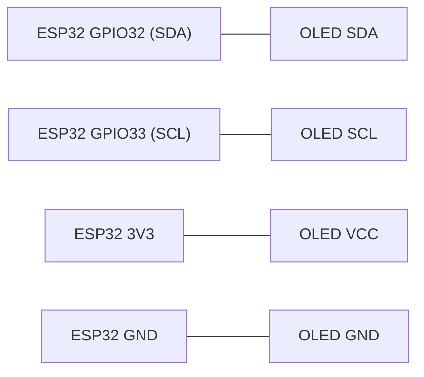
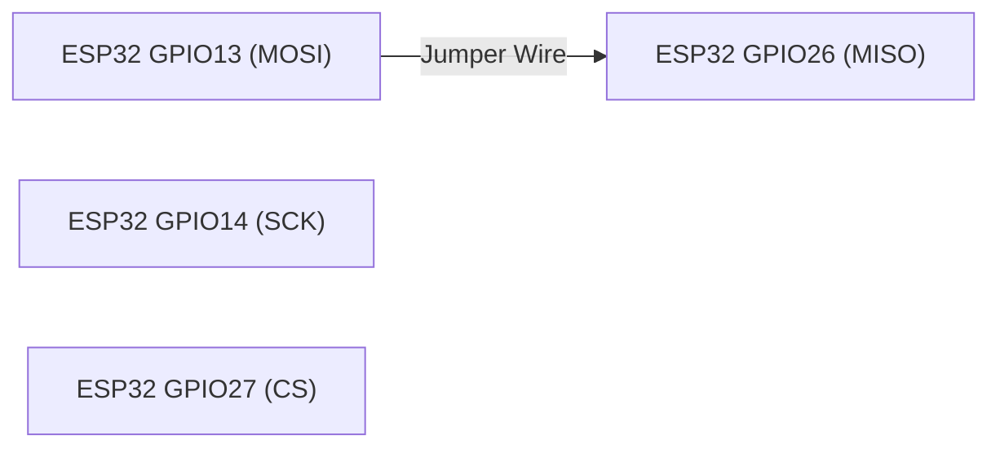

<div align="center">


### Laboratory Activity 8

**UART · I2C · SPI**

ESP32-DevKitC (ESP-WROOM-32) | Arduino IDE

*Laboratory Documentation and Experimental Results*

</div>

---

## Navigation

<div align="center">

<a href="#project-overview"></a>
<a href="#materials-and-equipment"></a>

<a href="#gpio-pin-assignments"></a>
<a href="#wiring-diagrams"></a>

<a href="#uart-loopback-testing"></a>
<a href="#i2c-scanner-testing"></a>

<a href="#spi-loopback-testing"></a>
<a href="#baud-rate-experiment"></a>

<a href="#expected-vs-observed-results"></a>
<a href="#guide-questions"></a>

<a href="#conclusion"></a>

</div>

---

## Project Overview


This laboratory activity verifies three wired communication interfaces on the ESP32 microcontroller: Universal Asynchronous Receiver/Transmitter (UART), Inter-Integrated Circuit (I2C), and Serial Peripheral Interface (SPI).

Each interface is tested using an Arduino sketch to observe its behavior under different connection conditions.

### Objectives

- Verify UART communication using a TX-to-RX loopback.
- Detect an I2C OLED display through address scanning.
- Verify SPI transfers using a MOSI-to-MISO loopback.
- Observe communication with and without physical connections.
- Examine the effects of mismatched baud rates.

---

## Materials and Equipment


| Component | Purpose |
|---|---|
| ESP32-DevKitC (ESP-WROOM-32) | Main microcontroller |
| USB Type-C Cable | Power and programming |
| Breadboard | Circuit prototyping |
| Jumper Wires | Communication connections |
| I2C OLED Display | Address detection |
| Computer | Programming and monitoring |
| Arduino IDE | Development environment |

---

## GPIO Pin Assignments


The following GPIO pins were assigned based on the laboratory requirements and lecture reference.

| Interface | Signal | GPIO |
|---|---|---|
| UART | TX | GPIO17 |
| UART | RX | GPIO16 |
| I2C | SDA | GPIO32 |
| I2C | SCL | GPIO33 |
| SPI | SCK | GPIO14 |
| SPI | MOSI | GPIO13 |
| SPI | MISO | GPIO26 |
| SPI | CS | GPIO27 |

**Note:** GPIO27 was used instead of GPIO4 for SPI CS to avoid using a strapping pin.

---

## Wiring Diagrams


The following diagrams show the connections used during each communication test.

### UART Loopback


**Connection:** GPIO17 (TX) to GPIO16 (RX).

The UART loopback connection allows transmitted data to return directly to the receiving pin.

### I2C OLED



| OLED Pin | ESP32 Connection |
|---|---|
| SDA | GPIO32 |
| SCL | GPIO33 |
| VCC | 3V3 |
| GND | GND |

The OLED uses SDA and SCL for I2C communication and receives power from the ESP32's 3.3V supply.

### SPI Loopback



**Connection:** GPIO13 (MOSI) to GPIO26 (MISO).

GPIO14 (SCK) and GPIO27 (CS) are configured in the sketch without additional external jumper connections for the loopback test.

---

## UART Loopback Testing


**Source Code:** [uart_loopback.ino](uart_loopback/uart_loopback.ino)

### Configuration

| Parameter | Setting |
|---|---|
| Interface | Serial2 |
| UART TX | GPIO17 |
| UART RX | GPIO16 |
| UART Baud Rate | 9600 |
| USB Serial Baud Rate | 115200 |
| Data Format | 8N1 |
| Transmission Interval | 1 second |

### Test 1 — With Jumper

**Expected:** The Serial Monitor displays `PING` every second.

**Observed:** Repeated `PING` messages were successfully received through the loopback connection.

```text
PING
PING
PING
PING
```

<details>
<summary><b>View UART With Jumper Screenshot</b></summary>


</details>

### Test 2 — Without Jumper

**Expected:** No new `PING` messages should be received after disconnecting TX and RX.

**Observed:** Previously displayed messages remained in the Serial Monitor, while incoming messages stopped after the jumper was disconnected.

<details>
<summary><b>View UART Without Jumper Screenshot</b></summary>


</details>

### Analysis

UART uses separate TX and RX pins to transmit and receive serial data. Connecting these pins creates a loopback path that allows transmitted data to be received by the same ESP32.

When the jumper is removed, the return path is disconnected.

[](#navigation)

---

## I2C Scanner Testing


**Source Code:** [i2c_scanner.ino](i2c_scanner/i2c_scanner.ino)

### Configuration

| Parameter | Setting |
|---|---|
| Interface | I2C (Wire) |
| SDA | GPIO32 |
| SCL | GPIO33 |
| Peripheral | OLED Display |
| Detected Address | 0x3C |
| Serial Monitor | 115200 baud |

### Test 3 — With OLED

**Expected:** The scanner detects the OLED's I2C address.

**Observed:** The ESP32 detected the OLED display at address `0x3C`.

```text
Found device at 0x3C
```

<details>
<summary><b>View I2C With OLED Screenshot</b></summary>


</details>

### Test 4 — Without OLED

**Expected:** The scanner reports that no I2C devices were detected.

**Recorded output:**

```text
No I2C devices found
```

<details>
<summary><b>View I2C Without OLED Screenshot</b></summary>


</details>

### Analysis

I2C uses SDA and SCL lines to communicate with peripheral devices using unique addresses.

The OLED responded at `0x3C`, confirming successful device detection. The display did not need to show text because the scanner only checked for device acknowledgment.

[](#navigation)

---

## SPI Loopback Testing


**Source Code:** [spi_loopback.ino](spi_loopback/spi_loopback.ino)

### Configuration

| Parameter | Setting |
|---|---|
| Interface | SPI |
| SCK | GPIO14 |
| MOSI | GPIO13 |
| MISO | GPIO26 |
| CS | GPIO27 |
| Clock Frequency | 1 MHz |
| Bit Order | MSB First |
| SPI Mode | Mode 0 |
| Transmitted Byte | 0xA5 |

### Test 5 — With Jumper

**Expected:** The received byte matches the transmitted byte `0xA5`.

**Observed:** The ESP32 consistently received `0xA5`, confirming successful SPI loopback communication.

```text
Sent 0xA5, received 0xA5
Sent 0xA5, received 0xA5
Sent 0xA5, received 0xA5
```

<details>
<summary><b>View SPI With Jumper Screenshot</b></summary>


</details>

### Test 6 — Without Jumper

**Expected:** The received byte differs from `0xA5` because MOSI and MISO are disconnected.

**Observed:** The ESP32 consistently received `0x00` instead of `0xA5`.

```text
Sent 0xA5, received 0x00
Sent 0xA5, received 0x00
Sent 0xA5, received 0x00
```

<details>
<summary><b>View SPI Without Jumper Screenshot</b></summary>


</details>

### Analysis

SPI uses separate MOSI and MISO lines and a dedicated clock signal. Connecting MOSI and MISO allows transmitted data to be received through the same microcontroller.

Without the jumper, MISO becomes unconnected and its received value is not guaranteed. During the experiment, the received byte was `0x00`.

[](#navigation)

---

## Baud Rate Experiment


This experiment examines the effects of using different baud rates between the ESP32's USB serial connection and the Arduino Serial Monitor.

The UART loopback connection remained between GPIO17 and GPIO16.

### Test 7 — Mismatched Baud Rates

| Parameter | Setting |
|---|---|
| Serial.begin() | 9600 |
| Serial2.begin() | 9600 |
| Serial Monitor | 115200 baud |

**Expected:** The output becomes unreadable because the baud rates do not match.

**Observed:** The Serial Monitor displayed garbled characters represented by square symbols.

<details>
<summary><b>View Baud Rate Mismatch Screenshot</b></summary>


</details>

### Test 8 — Matched Baud Rates

| Parameter | Setting |
|---|---|
| Serial.begin() | 9600 |
| Serial2.begin() | 9600 |
| Serial Monitor | 9600 baud |

**Expected:** Readable `PING` messages appear every second.

**Observed:** The Serial Monitor displayed repeated, readable `PING` messages after setting both baud rates to 9600.

```text
PING
PING
PING
PING
```

<details>
<summary><b>View Matched Baud Rate Screenshot</b></summary>


</details>

### Analysis

UART communication requires matching baud rates because data bits are interpreted according to timing.

When the ESP32 USB serial baud rate and the Serial Monitor baud rate differed, the output became unreadable. Matching both baud rates restored readable communication.

After testing, the USB serial connection was restored to 115200 baud.

[](#navigation)

---

## Expected vs Observed Results


| Test | Expected | Observed |
|---|---|---|
| UART with jumper | `PING` every second | Repeated `PING` messages |
| UART without jumper | No new `PING` | Incoming messages stopped |
| I2C with module | OLED address detected | `Found device at 0x3C` |
| I2C without module | No devices detected | `No I2C devices found` |
| SPI with jumper | Receives `0xA5` | Received `0xA5` |
| SPI without jumper | Different received value | Received `0x00` |
| Sketch 9600, Monitor 115200 | Unreadable output | Garbled square symbols |
| Sketch 9600, Monitor 9600 | Readable `PING` | Repeated `PING` messages |

---

## Guide Questions


### 1. Why does UART need both sides to use the same baud rate, while SPI uses a clock line?

UART is asynchronous and does not have a separate clock signal, so both devices must use matching baud rates to interpret transmitted bits correctly. SPI uses a dedicated clock line to synchronize data transmission and reception.

### 2. Why can two devices with the same address not share one I2C bus?

Two I2C devices with the same address would respond to the same communication request, potentially causing bus conflicts and incorrect data transmission.

### 3. Why is CS set HIGH between SPI transfers?

CS is set HIGH to deselect the SPI device when no communication is taking place. This prevents unintended communication and allows other SPI devices to use the bus.

[](#navigation)

---

## Conclusion


Laboratory Activity 8 demonstrated the operation of three wired communication interfaces using the ESP32-DevKitC: UART, I2C, and SPI.

UART loopback successfully returned transmitted `PING` messages when TX and RX were connected. The I2C scanner detected an OLED display at address `0x3C`, while SPI loopback successfully returned the transmitted byte `0xA5`.

The experiments also demonstrated how removing physical connections affects communication and how mismatched serial baud rates produce unreadable output.

Overall, the activity provided practical experience in configuring, testing, and troubleshooting wired communication interfaces using the ESP32 microcontroller.

---

<div align="center">

### BCA188 — Laboratory Activity 8

*Wired Communication | UART · I2C · SPI*

<a href="#navigation"></a>

</div>
